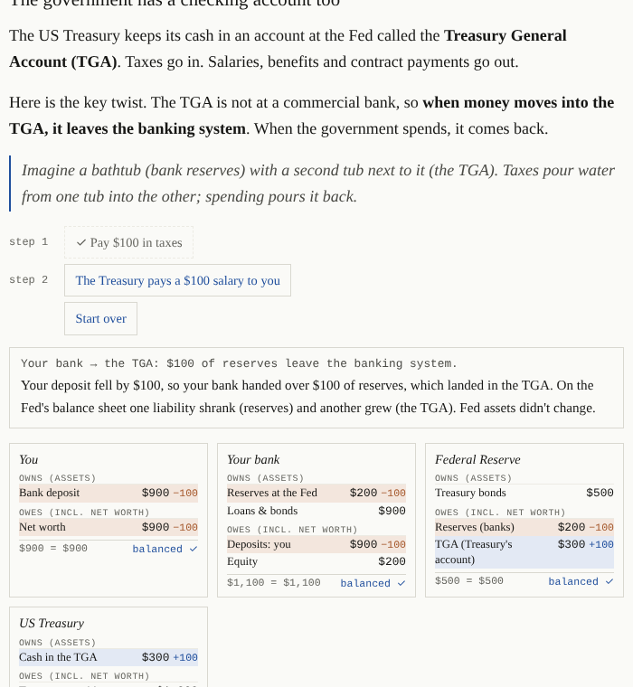
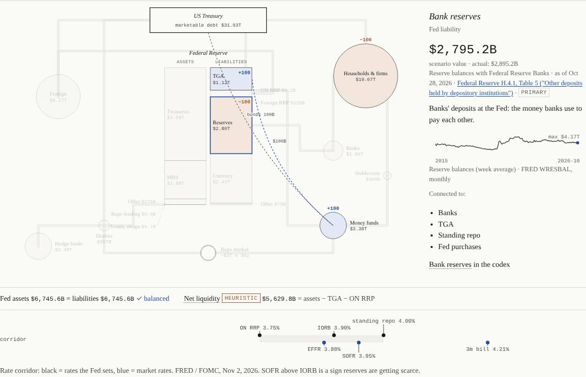
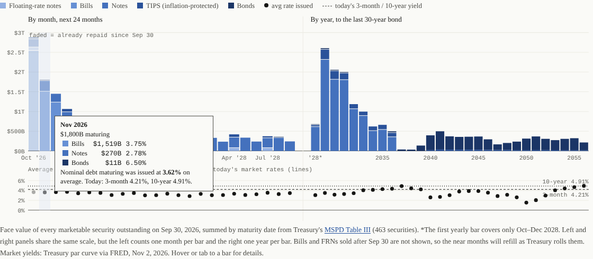

# The Debt & The Plumbing

An interactive explainer of the US federal debt and the "plumbing" that moves dollars between the Treasury, the Federal Reserve, banks, money market funds, repo markets, foreign holders and stablecoins. It's written for curious non-specialists and set up like a strategy game's codex: every term is clickable, every number is dated and sourced.

**Open `index.html` in any browser.** It is one self-contained file, with no server, no build step and no external requests.



## What's inside

| Section | What you can do |
|---|---|
| **Start here** | Eight short lessons (about 10 minutes): IOUs and reserves → the Treasury's account at the Fed → borrowing with bills → short vs long debt → QE and QT → the ON RRP → repo and leverage → the Fed's rate corridor. Each has toy balance sheets you change with a button, a live "in real life" figure and a self-check question. |
| **Part I · The Debt** | Gross vs public vs marketable debt with an estimate ticker, the mix of bills/notes/bonds/TIPS/FRNs, a **maturity wall** built from every security Treasury has outstanding, a **refinancing simulator** (short rate, long rate, bill share) and who owns the debt. |
| **Part II · The Plumbing** | A to-scale map of the Fed's balance sheet and the buckets around it, with **seven step-by-step scenarios** (bill issuance, tax day and TGA rebuild, QT, quarter-end repo squeeze, a rate cut, a stablecoin inflow, a basis-trade unwind). After every step the page checks that the books still balance. A **time machine** replays the real balance sheet month by month since 2007, with key events. |
| **Part III · Connections** | A decoder for headline phrases ("the RRP is drained", "term premium is rising", "fiscal dominance"…), the rate corridor since 2024, a crypto bridge (stablecoins, net liquidity, real yields, the dollar, with caveats), the global dollar, and how the US compares with Japan and the UK. |
| **Codex & Sources** | 80 defined terms, each tagged *fact* or *heuristic*, and every figure grouped by publisher with its date, status and link. |





## How the numbers are kept honest

- **One data file.** Every figure lives in `data/data.json` with `value`, `asOf`, `source`, `url` and a `status`: `primary` (read from the publisher's own data), `secondary`, `derived` (formula stored), `conflict` or `recall`. The page shows the status next to each figure.
- **Re-checked against the source.** `scripts/verify-figures.mjs` re-downloads 170 figures from Treasury Fiscal Data, Treasury TIC and press releases, the Fed's H.4.1 and Z.1, the Monthly Treasury Statement, the NY Fed and FRED, and compares them with `data.json`. Last run: **2026-11-05, 170/170 matched** ([docs/verification.md](docs/verification.md)). About 28 figures can't be machine-checked and stay labeled on the page as secondary, derived or conflicting.
- **Facts vs heuristics.** Accounting identities are stated as facts. Market rules of thumb (net liquidity, "ample" reserves, term premium) are labeled as heuristics, with the competing views. The page takes no position on whether the debt is good or bad.
- **Open questions** are listed as TODO-verify in [docs/mechanisms.md](docs/mechanisms.md), which also documents every flow in the system with its balance-sheet entries.

## Checks

```bash
node --test
```

Runs 29 tests:
- **Scenarios:** every step keeps Fed assets = liabilities and moves bank reserves and deposits together.
- **Lessons:** every toy balance sheet balances after every action, and lines that are two views of the same money (a bank's reserves and the Fed's liability to it) stay equal.
- **Refinancing simulator:** tested for its starting run-rate, conservation and convergence.

```bash
node scripts/validate-data.mjs
```

Checks data structure, glossary links and accounting identities. A GitHub Actions workflow (`.github/workflows/check.yml`) runs both on every push, and also fails if `index.html` is out of sync with `data/*.json`.

The page was also checked in headless Chromium:
- **Accessibility:** axe-core reports no violations in light, dark and mobile views. There is a keyboard walkthrough (skip link, arrow-key scenario tabs, focus handling for popovers and tooltips).
- **Mobile:** no horizontal scroll and 24px touch targets on phone and tablet sizes.

## Keeping the data current

**Updates are automatic and need no Claude usage.** The GitHub Actions workflow `.github/workflows/update-data.yml` runs every Friday (after the Fed's Thursday H.4.1 release); you can also start it by hand from the Actions tab. It runs plain Node scripts that:

1. `scripts/update-data.mjs` writes the latest values into `data/data.json` for every figure with a machine-readable primary source:
   - Debt to the Penny, the Daily Treasury Statement and the H.4.1 Fed balance sheet;
   - the MSPD and average interest rates;
   - TIC foreign holdings and Z.1 holders by sector;
   - FRED rates and yields, and NY Fed repo volumes.

   It checks that the Fed balance sheet still balances before writing.
2. `build-maturities-mspd.mjs`, `fetch-history.mjs` and `fetch-rates.mjs` rebuild the maturity schedule and histories.
3. `sync-data.mjs` copies the data into `index.html`.
4. The data checks and tests run, and the result is committed only if they pass.

**What still needs a person** (or Claude):
- figures from press releases (Treasury borrowing estimates and refunding statements, once a quarter) and other secondary figures;
- prose that names specific events, and the scenario amounts;
- re-pinning `scripts/verify-figures.mjs` for a new full verification. Its checks compare against fixed snapshot dates.

The page header shows both the last automatic update and the last full verification.

To run the update locally (Node 22+; uses `HTTPS_PROXY` if set):

```bash
node scripts/update-data.mjs --dry-run
```

`--dry-run` prints what would change without writing. Without it, run the rebuild scripts and `node scripts/sync-data.mjs`, then `node --test`.

**Improving the sources.** About 28 figures are still secondary because their publishers block automated access, or because their hosts weren't reachable from the build environment. [docs/data-access.md](docs/data-access.md) lists each one, where the primary version lives, and how to automate it. Most would work from GitHub Actions as-is.

## Publishing

`index.html` works anywhere static files are served, for example GitHub Pages. To publish it as a claude.ai Artifact, whose host adds its own `<html>/<head>/<body>` wrapper, first make a wrapper-free copy:

```bash
node scripts/build-artifact.mjs /path/to/out.html
```

## Files

| Path | Purpose |
|---|---|
| `index.html` | The page: data block (generated), then the tested engine (scenarios, lessons, simulator), then the UI |
| `data/data.json` | Every figure with value, date, source, link and status |
| `data/maturities.json` | Maturity schedule from MSPD Table III (463 securities, Sep 30 2026) |
| `data/maturities-model.json` | An earlier approximate model, kept for comparison |
| `data/history.json`, `data/rates-history.json` | Monthly and daily history series (FRED, MSPD) |
| `data/glossary.json` | 80 terms: definition, why it matters, related terms, fact/heuristic |
| `docs/mechanisms.md` | Every flow with T-accounts; TODO-verify list |
| `docs/verification.md` | Latest source-verification report |
| `docs/data-access.md` | How to get each still-secondary figure from its primary source |
| `scripts/` | Automatic update, rebuild, verification, sync, artifact build and validation scripts (see above) |
| `tests/scenarios.test.mjs` | Balance-sheet tests for scenarios, lessons and the simulator |

## Known limitations

- Data updates weekly and automatically for primary-source figures. Narrative text and quarterly press-release figures need occasional manual review.
- Still secondary for lack of an accessible primary source: money-fund totals (ICI blocks automated access), hedge-fund repo borrowing (SEC Form PF), stablecoin supply and Tether/Circle reserves, OFR's repo-market size, and the Japanese rate figures. Legal dates and CBO projections were read through search excerpts and are labeled secondary.
- The refinancing simulator is a sketch of the mechanics, not a forecast: TIPS at their real coupon, FRNs treated as bills, a fixed primary deficit.
- The lessons' toy balance sheets simplify on purpose (for example, the Treasury's "net position" as a balancing line).

Not yet built: average-maturity comparisons with Japan and the UK (needs the UK Debt Management Office and Japan's Ministry of Finance data, see docs/data-access.md).
